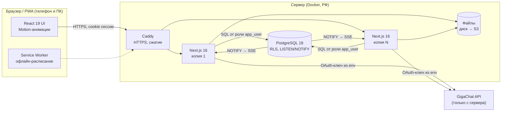
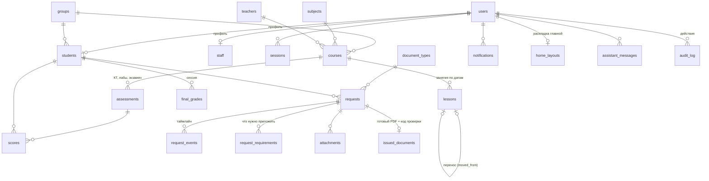
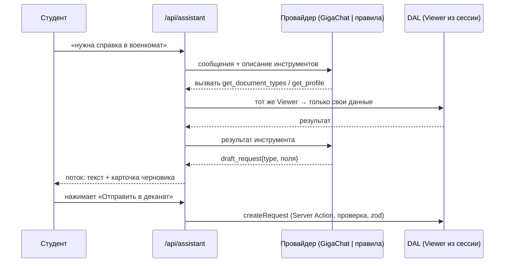

# «деканат*» – архитектура прототипа

> Концепт личного кабинета студента для конкурса «Цифровой деканат будущего».
> Не официальный сервис вуза. Все данные вымышленные.

Документ – источник истины для всех фаз разработки. Он написан до первой строчки кода. Его читают и люди, и ИИ-агенты: правило «если код расходится с документом – сначала обнови документ».

---

## 0. Из чего исходим

| Требование ТЗ | Что из него следует в архитектуре |
|---|---|
| Работающий прототип: войти, расписание, оценки, подать заявку, увидеть статус | Настоящий сервер и БД. Никаких моков в браузере |
| Стек «гибкий с точки зрения масштабирования» | Приложение без состояния (stateless), состояние только в PostgreSQL и файловом хранилище. Можно запустить N копий |
| Студент видит только свои данные, даже подставив чужой адрес | Два независимых слоя защиты: слой доступа к данным в коде (DAL) и Row-Level Security в самой БД. Чужое = 404 |
| Пароли не в открытом виде | argon2id |
| Ключи (в т. ч. ИИ) не в коде и не в браузере | Только переменные окружения сервера. ИИ вызывается только с сервера. Проверка бандла на утечки |
| Телефон от 360 px | Мобильная композиция – основная, проверяется на 360 / 390 px автотестами |
| Открывается из России без VPN до 28 ноября | Российский хостинг, без внешних CDN и Google Fonts в рантайме |
| Тестовые аккаунты: 2 студента + сотрудник | Сид-данные с двумя разными студентами и методистом. Кабинет сотрудника – живая смена статусов |
| Критерий «масштаб ИИ»: процесс, промпты, файлы для агентов | `CLAUDE.md`, агенты-ревьюеры в `.claude/agents`, журнал промптов и ошибок ИИ в `docs/process/` |
| Пожелание: максимальное сходство с дизайном и много качественных анимаций | Дизайн-токены из макетов, визуальная сверка скриншотами, отдельная система движения (раздел 9) |

**Принципы**

1. **Безопасно по умолчанию.** Забытая проверка должна давать «ничего не видно», а не «видно всё».
2. **Сервер – главный.** Данные читаются в серверных компонентах. В браузер уходит только то, что нужно экрану.
3. **Один источник правды для внешнего вида.** Токены из макетов – в одном файле. Цвета и радиусы «на глаз» запрещены.
4. **Движение – часть интерфейса, а не украшение.** Каждая анимация объясняет, что произошло. Работает на 60 fps и уважает «уменьшить движение».
5. **Каждая фаза заканчивается рабочим, задеплоенным состоянием.**

---

## 1. Общая схема



- **Next.js** отдаёт страницы (серверные компоненты), принимает действия (Server Actions) и держит два API: поток событий (`/api/events`, SSE) и поток помощника (`/api/assistant`).
- **PostgreSQL** хранит всё: пользователей, сессии, расписание, оценки, заявки, уведомления, раскладку главной. Через `LISTEN/NOTIFY` рассылает события всем копиям приложения.
- **Файлы** (вложения к заявкам, готовые PDF-справки) лежат за интерфейсом `Storage`. Для прототипа это том на диске, для масштаба – S3-совместимое хранилище. Меняется одной строкой конфигурации.
- **GigaChat** вызывается только сервером. Браузер не знает ни ключа, ни адреса API.

---

## 2. Стек и почему

| Слой | Выбор | Почему |
|---|---|---|
| Фреймворк | **Next.js 16** (App Router) + **React 19** + **TypeScript strict** | Серверные компоненты: данные не уходят в браузер без нужды. Server Actions для форм. Стриминг и Suspense – готовые состояния загрузки. Один язык на клиенте и сервере |
| Стили | **Tailwind CSS 4** + CSS-переменные токенов | Токены макета → тема Tailwind. Быстро, без рантайма |
| Доступные примитивы | **Radix UI** (Dialog, Popover, DropdownMenu, Tabs) | Фокус, клавиатура и ARIA «из коробки», внешний вид полностью свой |
| Анимации | **Motion** (`motion/react`, через `LazyMotion`) | Пружины, layout-анимации (FLIP), общий элемент между экранами (`layoutId`), жесты и drag, `AnimatePresence`, учёт reduced-motion |
| Перетаскивание | **dnd-kit** | Сетка блоков главной с разными размерами (S/M/L), клавиатурное перетаскивание |
| БД | **PostgreSQL 18** | Надёжно, масштабируется, есть RLS и LISTEN/NOTIFY |
| ORM и миграции | **Drizzle ORM** + drizzle-kit, драйвер `postgres` | SQL прозрачен: видно `where student_id = …` в каждом запросе. Нет бинарных движков, лёгкий Docker-образ. Политики RLS описываются в схеме |
| Валидация | **zod** | Каждый вход (форма, action, тело API, ответ ИИ-инструмента) проверяется схемой |
| Пароли | **argon2id** (`@node-rs/argon2`) | Рекомендация OWASP. Параметры: m = 19 МиБ, t = 2, p = 1 |
| Даты | **date-fns** + **@date-fns/tz** | Часовой пояс вуза – настройка, а не время сервера |
| PDF-справки | **pdf-lib** + встроенный шрифт Inter Tight | Генерация справки с QR-кодом проверки прямо на сервере |
| PWA | **Serwist** (или свой небольшой service worker, если Serwist не дружит со сборщиком Next 16) | Офлайн-оболочка и кэш расписания на сегодня |
| Шрифт | **Inter Tight** через `next/font` (SIL OFL) | Шрифт кладётся в сборку, в рантайме нет запросов к Google |
| Иконки | собственные SVG из макетов + **Lucide** (ISC) | Лицензии разрешают использование |
| Тесты | **Vitest** (логика, DAL с настоящей БД), **Playwright** (сценарии, безопасность, скриншоты) | Безопасность проверяется тестами, а не обещанием |
| Инфраструктура | **Docker** (standalone-сборка Next), **docker compose**: app + postgres + caddy | Один и тот же образ локально и на сервере. Caddy сам получает HTTPS-сертификат |
| CI | GitHub Actions: lint → typecheck → тесты → сборка образа | Ни один коммит не ломает сценарии незаметно |

**Правило зависимостей.** Версии фиксируются точно (без `^`), lockfile в репозитории. Не ставим версии моложе 14 дней – защита от атак через подменённые пакеты. `npm audit` в CI.

---

## 3. Структура репозитория

```
dekanat/
├─ CLAUDE.md                  # правила проекта для ИИ-агентов
├─ .claude/agents/            # агенты: дизайн-ревьюер, аудитор безопасности, тестировщик
├─ design/boards/             # финальные макеты (.dc.html) – эталон внешнего вида
├─ docs/
│  ├─ architecture.md         # этот документ
│  ├─ decisions/              # ADR: короткие записи «решили X, потому что Y»
│  ├─ security.md             # модель угроз и как закрыта каждая
│  └─ process/                # журнал промптов, ошибок ИИ, скриншоты → PDF для жюри
├─ src/
│  ├─ app/
│  │  ├─ (auth)/login/
│  │  ├─ (student)/           # layout: шапка ПК / таб-бар телефона
│  │  │  ├─ page.tsx          # Сегодня (главная)
│  │  │  ├─ week/  study/  study/[courseId]/
│  │  │  ├─ documents/  documents/new/  documents/[id]/
│  │  │  ├─ notifications/  profile/  assistant/
│  │  ├─ (staff)/staff/       # кабинет сотрудника деканата
│  │  ├─ verify/[code]/       # публичная проверка подлинности справки
│  │  └─ api/ events/  assistant/  files/[id]/  health/
│  ├─ server/                 # только сервер (import 'server-only')
│  │  ├─ db/                  # схема Drizzle, клиент, RLS-контекст
│  │  ├─ auth/                # пароли, сессии, лимиты попыток, requireStudent/requireStaff
│  │  ├─ dal/                 # ЕДИНСТВЕННЫЙ путь к данным: schedule, grades, requests…
│  │  ├─ services/            # бизнес-логика: смена статуса, перенос пары, PDF
│  │  ├─ events/              # NOTIFY/LISTEN, рассылка в SSE
│  │  ├─ proactive/           # правила «деканат сам напоминает»
│  │  ├─ ai/                  # провайдеры помощника, инструменты, промпты
│  │  └─ storage/             # Storage: disk | s3
│  ├─ components/
│  │  ├─ ui/                  # примитивы: Button, Card, Chip, IconTile, Sheet, ListRow…
│  │  ├─ motion/              # анимационный кит: Odometer, Stagger, SharedCard…
│  │  └─ features/            # schedule/, grades/, documents/, assistant/, home-grid/
│  ├─ lib/                    # общие утилиты без доступа к данным (время, форматирование)
│  └─ styles/tokens.css       # токены из макетов
├─ drizzle/                   # SQL-миграции (включая политики RLS)
├─ seed/                      # вымышленные данные: студенты, семестр, заявки
├─ tests/  unit/  e2e/  security/  visual/
├─ docker/  Dockerfile  compose.yaml  Caddyfile
└─ .env.example               # имена переменных без значений
```

Граница `server/` охраняется дважды. Пакет `server-only` роняет сборку, если клиентский компонент его импортирует. Правило ESLint запрещает импорт `server/db` откуда-либо, кроме `server/dal` и `server/services`.

---

## 4. Модель данных



Ключевые решения:

- **`users`** отделены от **`students`/`staff`**. Логин и хеш пароля живут отдельно от персональных данных профиля, роль – `student | staff`.
- **`lessons` – конкретные занятия по датам**, а не шаблон «каждый понедельник». Перенос, замена аудитории и отмена – это поля занятия:
  - `status`: `scheduled | moved | cancelled`;
  - `moved_from_id`, `previous_room`, `change_note`, `changed_at`.

  Поэтому «заметные изменения» строятся одним запросом, и у каждого изменения есть история. Сид генерирует весь семестр (сентябрь–декабрь + январская сессия) на реальные даты: в какой бы день жюри ни открыло кабинет, расписание живое.
- **Успеваемость** – модель балльно-рейтинговой системы:
  - курс → контрольные точки (`assessments`, макс. баллы, даты) → баллы студента (`scores`);
  - порог допуска хранится у курса – отсюда «не хватает 2 баллов» и калькулятор;
  - итоги сессии лежат в `final_grades`.
- **Заявки**:
  - `document_types` описывает тип справки: поля формы (JSON-схема), форматы получения, нужные документы, ориентировочный срок текстом, основание;
  - `requests.status`: `sent → in_progress → need_action → ready → issued`, плюс `rejected` и `cancelled`;
  - каждая смена статуса – строка в `request_events`. Таймлайн на экране строится из них;
  - точной даты готовности может не быть: поля `eta_from`/`eta_to` необязательны, тогда показываем срок «по правилу» из типа документа – как в макете.
- **Номер заявки** (№1058) – отдельная последовательность. Наружу в URL идёт непредсказуемый UUID, а номер – только для людей.
- **Уведомления** создаются «веером при записи»: событие сразу пишет строки нужным пользователям одним `INSERT … SELECT`. Чтение ленты – один индексный запрос.
- **Индексы** под реальные запросы:
  - `lessons(group_id, starts_at)`;
  - `requests(student_id, created_at desc)`;
  - `notifications(user_id, read_at, created_at desc)`;
  - `scores(student_id)`.

---

## 5. Безопасность

### 5.1 Вход и сессии
- Пароль → **argon2id**. Для несуществующего логина всё равно считается фиктивный хеш: время ответа одинаковое, нельзя узнать, есть ли логин.
- Ошибка всегда одна: «Неверный логин или пароль».
- **Лимит попыток**: 5 за 15 минут на пару «логин + IP», хранится в БД. Работает при нескольких копиях приложения.
- **Сессия**: 32 случайных байта, cookie `__Host-session`.
  - Флаги: `HttpOnly`, `Secure`, `SameSite=Lax`, `Path=/`.
  - В БД хранится только SHA-256 токена: утечка базы не даёт войти.
  - Срок 7 дней, продлевается при активности.
  - Выход удаляет сессию на сервере. В профиле есть «выйти на всех устройствах».

### 5.2 Доступ к данным: два слоя
1. **DAL (код).** Все чтения и записи идут только через `server/dal/*`. Каждая функция первым делом вызывает `requireStudent()`/`requireStaff()` и получает `Viewer` из сессии. `studentId` **никогда не берётся из URL, формы или тела запроса**, только из сессии. Запрос заявки по id выглядит так: `where id = $id and student_id = $viewer`. Чужая заявка неотличима от несуществующей и даёт **404**, а не 403: мы даже не подтверждаем, что такая заявка есть.
2. **Row-Level Security (БД).**
   - Приложение подключается к Postgres ролью `app_user`: без прав суперпользователя и без `BYPASSRLS`.
   - Каждый запрос DAL выполняется в транзакции, где установлены `app.user_id`, `app.student_id` и `app.role`.
   - Политики на таблицах с личными данными (`students`, `requests*`, `attachments`, `scores`, `final_grades`, `notifications`, `home_layouts`, `assistant_messages`) пропускают только свои строки. Сотруднику доступны строки, нужные по роли.
   - Если разработчик (или ИИ-агент) забудет условие в коде, база всё равно вернёт пустоту. **Ошибка приводит к закрытию, а не к утечке.**

Дополнительно:
- **Server Actions – это публичные эндпоинты.** Каждый проверяет сессию сам и валидирует вход через zod.
- `proxy.ts` (бывший middleware) только перенаправляет на вход. Он **не является** границей безопасности: проверка всегда в DAL.
- В браузер уходят DTO только с нужными полями. Объекты `users` помечены через React taint API (экспериментальный флаг Next): случайно передать хеш пароля в клиентский компонент нельзя.
- Caddy настроен на потоковую отдачу (`flush_interval -1`) для SSE и помощника.

### 5.3 Файлы
- Тип проверяется по сигнатуре (PDF, JPEG, PNG), а не по расширению. Размер до 10 МБ.
- Файлы хранятся вне `public/`. Отдаются через `/api/files/[id]` с проверкой владельца, заголовками `Content-Disposition: attachment` и `nosniff`.
- Имя файла очищается от опасных символов.

### 5.4 Секреты
- Только переменные окружения на сервере. В репозитории лежит `.env.example` без значений, `.env*` – в `.gitignore`.
- Ключ GigaChat читается только в `server/ai`. Временный токен доступа кэшируется в памяти сервера.
- **Проверки:** gitleaks в CI. Тест после сборки ищет в `.next/static` подстроки секретов и имена переменных окружения.

### 5.5 Заголовки и прочее
- CSP с nonce (без `unsafe-inline` для скриптов), `frame-ancestors 'none'`, HSTS, `X-Content-Type-Options`, `Referrer-Policy`, `Permissions-Policy`.
- Аудит-журнал: входы и все действия сотрудника (кто, что, когда).
- Только вымышленные персональные данные. Принцип минимизации: в профиле нет паспорта и даты рождения – для сценариев они не нужны.

### 5.6 ИИ-помощник и данные
- Инструменты помощника вызывают **те же функции DAL с тем же `Viewer`**. Модель физически не может получить данные другого студента.
- Действия с последствиями (подать заявку, отменить) модель только **готовит как черновик**. Отправка – нажатием кнопки человеком.
- В модель уходит минимум: без ФИО и номера зачётки, только то, что нужно для ответа.
- Лимит: 30 сообщений в час на пользователя.

### 5.7 Тесты безопасности (обязательны, гоняются в CI)
- **Матрица IDOR.** Студент A открывает URL заявки, файла и PDF студента B, вызывает их API и Server Actions – везде 404.
- Студент открывает `/staff/*` → 404. Без сессии → переход на вход.
- Перебор пароля → блокировка. Подделанная или просроченная cookie → вход.
- В БД все пароли начинаются с `$argon2id$`.
- В клиентском бандле нет секретов.
- **Тест RLS напрямую:** роль `app_user` с контекстом студента A делает `select * from requests` и видит только свои строки.

Модель угроз целиком описана в `docs/security.md`.

---

## 6. Масштабирование

- Копии Next.js **без состояния**: сессии в БД, файлы в Storage, события через Postgres. Масштабирование – это `replicas: N` за Caddy или балансировщиком.
- **Realtime между копиями.** Каждая копия держит одно `LISTEN`-соединение и раздаёт события своим SSE-клиентам. Сотрудник на копии 1 меняет статус – студент на копии 2 видит его сразу.
- **Кэш расписания по группе.** Расписание общее для группы, это не личные данные: кэшируем с тегом `schedule:group:{id}` и сбрасываем при переносе пары. Личные данные (оценки, заявки) в общий кэш не попадают никогда.
- Пул соединений. При росте – PgBouncer. Тяжёлые операции (PDF, ИИ) не блокируют обычные запросы.
- Фоновые задачи (проактивные напоминания) защищены advisory-lock в Postgres: при N копиях задача выполняется ровно один раз.

---

## 7. Время

- Часовой пояс вуза задаётся настройкой `UNIVERSITY_TZ`. «Сегодня», «через 10 мин», границы недели считаются в нём, а не во времени сервера (UTC).
- Время хранится в `timestamptz`, поэтому отсчёт верен в любом часовом поясе зрителя.
- **Демо-режим для жюри.** Кабинет открывают в случайное время: вечером, в воскресенье. В профиле есть переключатель «Показать учебный день». Он сдвигает «сейчас» на ближайшую учебную пару – только для этого пользователя и только в интерфейсе, данные не меняются. Без него жюри может увидеть лишь экран «пары закончились».

---

## 8. Фронтенд и соответствие макетам

### 8.1 Композиции
- **Телефон (< 1024 px)** – язык макетов A1Calm/B2Phone: оранжевый верх, тёплые нейтральные цвета, белая «простыня», таб-бар с иконками. На планшете колонка ограничена шириной 640 px и стоит по центру.
- **Компьютер (≥ 1024 px)** – язык B2Next: серый фон `#EFEFF4`, белые карточки, оранжевая главная карточка, шапка со строкой «Помощник», чёрные активные элементы. Контент до 1280 px по центру, сетка растягивается.
- Компоненты общие, раскладки разные. Предпочитаем адаптивные классы. Отдельные деревья – только там, где композиции принципиально разные (главная, неделя).

### 8.2 Токены из макетов (`src/styles/tokens.css`)
| Токен | Значение | Где |
|---|---|---|
| `--hero` | `#FF6A3D` | верх на телефоне |
| `--hero-wash` / `--hero-ink` | `#FFE2D4` / `#9E4317` | подсветка текущей пары |
| `--accent-desk` | `#FF6B2C` | главная карточка ПК |
| `--ink` / `--ink-2` | `#14141A` (ПК `#16161D`) / `#4B4B57` | текст |
| `--surface-2` / `--line` / `--canvas` | `#F4F1EF` / `#ECE6E2` / `#E9E4E0` | телефон |
| `--desk-bg` / `--desk-muted` | `#EFEFF4` / `#E6E6EC` | ПК |
| `--ok` / `--danger` / `--online` | `#0B6B43` / `#B42318` / `#1A3FA6` | статусы |
| радиусы | 28 (карточки), 24 (блоки), 16 (кнопки дней), 14 (кнопки), 10 (иконки) | |
| шрифт | Inter Tight 400–900 | везде |

Правила макета действуют как правила кода:
- не больше трёх оранжевых акцентов на «простыне»;
- одна чёрная главная кнопка на экран;
- статус пишется словами;
- зона касания ≥ 44 px.

### 8.3 Как гарантируем сходство
1. Экран собирается **по эталону `design/boards/*.dc.html`**: те же тексты, отступы, размеры.
2. Playwright снимает экран в размерах макета: 390×844 (телефон), 1086×844 (ПК), плюс 360×780 (проверка на узком).
3. Снимок кладётся **рядом с макетом** в отчёт `tests/visual/report.html`. Агент-дизайнер сверяет пару и пишет расхождения. Чиним, пока расхождений нет.
4. Принятый снимок становится эталоном визуальной регрессии: дальше любые случайные изменения ловятся автоматически.

### 8.4 Данные на экране
- Серверные компоненты читают DAL. Интерактивные острова – клиентские компоненты.
- Загрузка: `Suspense` + скелетоны в форме будущего содержимого (они нарисованы в макете B2PhoneB).
- Изменения: Server Action + `useOptimistic`. Интерфейс отвечает мгновенно, а при ошибке аккуратно откатывается (макет B2Errors).

---

## 9. Система движения (анимации)

### 9.1 Правила
- Анимируем только `transform`, `opacity`, `filter`, `clip-path`. Изменения раскладки – через FLIP (`layout` в Motion). Цель – 60 fps на среднем телефоне.
- Каждая анимация отвечает на вопрос «что произошло?»: откуда появилось, куда ушло, что изменилось. Бессмысленных бесконечных анимаций нет. Исключение – медленное «дыхание» кольца на главной карточке.
- Вход экрана – не дольше 600 мс. Анимация никогда не блокирует ввод: можно нажать, не дожидаясь конца.
- При `prefers-reduced-motion` движение заменяется мягким появлением, а счётчики сразу показывают итог.
- Motion грузится через `LazyMotion` + `m`-компоненты: в первый бандл попадает минимум.

### 9.2 Токены движения (`src/components/motion/tokens.ts`)
| Имя | Значение | Для чего |
|---|---|---|
| `spring.snappy` | stiffness 520, damping 38 | переключатели, «таблетки» выбора |
| `spring.soft` | stiffness 260, damping 30 | карточки, листы, общий элемент |
| `spring.bouncy` | stiffness 420, damping 18 | успех, счётчик колокольчика |
| `dur.fast/base/slow` | 140 / 240 / 420 мс | появления, затухания |
| `ease.out` | `cubic-bezier(.2,.8,.2,1)` | всё, что без пружины |
| `stagger` | 40 мс | списки и сетки |

### 9.3 Каталог (что и где движется)
| Экран | Анимации |
|---|---|
| **Вход** | Заголовок поднимается по словам. Ошибка – короткое «покачивание» поля. Успех – кнопка превращается в оранжевый круг, который разворачивается в верх главной (общий переход) |
| **Сегодня** | Цифры отсчёта «перекатываются» (одометр). Выбор дня – чёрная «таблетка» скользит по полосе (`layoutId`). Смена дня – карточки уезжают в сторону листания. Карточки появляются каскадом. Кольцо на главной карточке медленно дышит. У онлайн-пары, которая идёт сейчас, пульсирует точка «в эфире» |
| **Насыщенный день** | Карусель пар тянется пальцем и мышью с инерцией и «прилипанием». Прошедшие пары складываются в «2 прошли» и раскрываются |
| **Неделя** | Колонки дней появляются волной. Неделя листается с направлением. Перенос: карточка один раз мягко подсвечивается, пунктир «рисуется» |
| **Учёба** | Баллы считаются вверх от нуля. Полосы прогресса заполняются. Калькулятор отвечает пружиной. Предмет из списка «вырастает» в экран предмета (общий элемент) |
| **Заявки** | Новая заявка: поля проверки появляются по очереди, «±» перекатывает число. Отправка: кнопка → индикатор → галочка, карточка «улетает» в список. Таймлайн рисует линию по шагам, текущий шаг пульсирует. Смена статуса в реальном времени – вспышка карточки и перекат статуса |
| **Уведомления** | Колокольчик покачивается, счётчик перекатывается. Тост выезжает (сверху на телефоне, справа снизу на ПК). На телефоне смахивание отмечает прочитанным |
| **Помощник** | Строка «Помощник» из шапки разворачивается в панель (общий элемент). Ответ печатается потоком с кареткой. «Думаю: смотрю расписание…» – чипы с бегущим блеском. Черновик заявки собирается поле за полем |
| **Настройка главной** | В режиме правки блоки слегка покачиваются. Перетаскивание идёт с пружиной, соседи расступаются. S/M/L – плавное изменение размера. Скрытие – блок сворачивается в лоток «скрытые» |
| **Навигация** | На таб-баре активная подложка скользит. Переходы между разделами – по направлению. Нижний лист закрывается жестом вниз. Свой индикатор «потянуть, чтобы обновить» |
| **Состояния** | Скелетоны с бегущим блеском повторяют форму содержимого. Плашка «нет сети» выезжает и уезжает. Ошибки появляются на месте, без прыжков страницы |

Каждая анимация из каталога – компонент или хук в `components/motion`:
- `Odometer`, `Stagger`, `SlidingPill`, `SharedCard`, `DrawLine`, `CountUp`, `Shimmer`, `Toast`, `SwipeRow`, `DragSheet`.

Экраны собираются из них. Поэтому движение единообразно по всему кабинету.

---

## 10. ИИ-помощник



- **Интерфейс `AssistantProvider`** с двумя реализациями:
  - `GigaChatProvider` – function calling, потоковый ответ;
  - `RulesProvider` – разбор намерений по ключевым словам.

  Если ключа нет, лимит исчерпан или сеть упала, помощник продолжает работать на правилах. **Демо никогда не ломается.** Позже можно подключить YandexGPT той же реализацией интерфейса.
- **Инструменты** (общие для провайдеров, со схемами zod):
  - `get_schedule(date|week)`, `get_changes`;
  - `get_grades(course?)`, `calc_admission(course)`;
  - `list_requests`, `get_request(id)`, `get_document_types`;
  - `draft_request(type, fields)`;
  - `explain_rule(topic)` – справка по положениям из сид-базы.
- Ответ – поток SSE: кусочки текста плюс **структурированные карточки** (черновик заявки, пара, балл). Интерфейс рисует карточки своими компонентами, а не текстом модели.
- **GigaChat:**
  - OAuth: ключ авторизации из env → токен на 30 минут, кэшируется;
  - нужен корневой сертификат НУЦ Минцифры, подключается через `NODE_EXTRA_CA_CERTS`;
  - системный промпт хранится в `server/ai/prompts/` под версией и попадает в журнал процесса.
- **Проактивный деканат** (`server/proactive`) – правила, а не ИИ. Срабатывают по событиям и раз в час под advisory-lock:
  - «КТ через 2 дня»;
  - «до допуска не хватает 2 баллов»;
  - «справка готова»;
  - «пару перенесли».

  Результат – уведомления и строка «По делам» на главной.

---

## 11. Реальное время

- `GET /api/events` – SSE. Проверяется cookie, клиент подписывается на канал `user:{id}`.
- Сервис, меняющий данные (статус заявки, перенос пары), в той же транзакции пишет уведомление и делает `pg_notify('events', {userId, kind, id})`.
- Копия приложения получает событие и отправляет его своим подписчикам. Клиентский хук `useLiveEvents` показывает тост и делает `router.refresh()` нужного сегмента.
- Каждые 25 с идёт «пульс», при обрыве – переподключение с `Last-Event-ID`. Пропущенное подтягивается из ленты уведомлений: события не теряются.

---

## 12. Кабинет сотрудника (методист деканата)

Нужен, чтобы жюри увидело живой цикл заявки, а не нарисованные статусы.
- **Очередь заявок** с фильтрами. Карточка заявки: взять в работу, запросить документ (с комментарием), отметить «готова» – сервер сам генерирует PDF справки с QR – или выдать.
- **Перенос пары и смена аудитории.** Студенты группы получают уведомление, в расписании появляется заметное изменение.
- **Объявление** для группы или факультета.

Визуально это тот же язык B2Next, только с плотными таблицами. Отдельные макеты рисуем в фазе 7 до кода.

---

## 13. Развёртывание

- `Dockerfile`: многоступенчатая сборка, `output: 'standalone'`, запуск не от root, healthcheck на `/api/health`.
- `compose.yaml`:
  - `app` – образ приложения;
  - `db` – `postgres:18`, том, отдельные роли `owner` (миграции) и `app_user` (приложение);
  - `caddy` – HTTPS, gzip/zstd, заголовки.
- **Хостинг в РФ** (решение за тобой, см. раздел 16): VPS Timeweb Cloud / Selectel или Amvera.
- **Выкатываем рано.** «Скелет» с экраном входа выкладывается уже в фазе 1, и доступность из РФ проверяется сразу, а не в последний день.
- Резервная копия БД (`pg_dump`) раз в сутки. Сид можно перезапустить командой: если жюри «сломает» данные, восстанавливаем за минуту.

---

## 14. Процесс разработки с ИИ (это оценивается)

- **`CLAUDE.md`** – правила проекта:
  - стек и запреты (данные только через DAL, токены вместо цветов, анимации только из кита);
  - определение «готово» для экрана;
  - как запускать тесты.
- **`.claude/agents/`:**
  - `design-reviewer` – сверяет снимок экрана с макетом и правилами дизайна;
  - `security-auditor` – ищет IDOR, утечки секретов, пропущенные проверки и сам пишет тест на каждую находку;
  - `motion-reviewer` – проверяет анимации на смысл, плавность и reduced-motion;
  - `test-writer` – сценарии Playwright по описанию экрана.
- **`docs/process/`:**
  - журнал ключевых промптов по фазам;
  - журнал ошибок ИИ («что сделал не так → как заметили → как исправили»);
  - скриншоты до и после.

  Из этого в конце собирается PDF для жюри, а не пишется по памяти.
- `docs/decisions/` – короткие ADR на каждое заметное решение.

---

## 15. Фазы

Каждая фаза закрывается по одному **определению «готово»**:
- сценарии фазы проходят в Playwright на 360/390/1086 px;
- визуальная сверка с макетом принята;
- тесты безопасности зелёные;
- коммит и выкладка на сервер;
- запись в журнал процесса со скриншотами.

| # | Фаза | Результат |
|---|---|---|
| 0 | **Архитектура** | Этот документ и ответы на открытые вопросы |
| 1 | **Фундамент** | `security.md`, репозиторий, Next.js, линтеры, Docker + Postgres, схема и миграции с RLS, сид (2 студента + методист, весь семестр), `CLAUDE.md` и агенты, CI. **Скелет выложен на хостинг** |
| 2 | **Дизайн-система и анимационный кит** | Токены, шрифт, примитивы, `components/motion`, страница `/dev/kit` со всеми компонентами, сверка с макетами |
| 3 | **Вход, сессии, профиль** | Экран входа как в макете, argon2id, лимиты, роли, DAL, RLS-контекст, профиль. Матрица IDOR-тестов заведена |
| 4 | **Расписание** | Сегодня (ПК + телефон), насыщенный день с каруселью, неделя (ПК + телефон), изменения и переносы, живой отсчёт, выходной |
| 5 | **Успеваемость** | Учёба, предмет, баллы, допуск, калькулятор, сессия |
| 6 | **Заявки и справки** | Список, новая заявка, деталь с таймлайном, «нет точной даты», «нужно действие», вложения, PDF с QR, `/verify` |
| 7 | **Сотрудник, уведомления, реальное время** | Кабинет методиста, лента уведомлений, SSE, тосты, проактивные правила, «По делам» |
| 8 | **Помощник** | GigaChat + правила, инструменты, черновик заявки, поток с карточками |
| 9 | **Главная под себя и состояния** | Перетаскивание, S/M/L, скрытие; загрузка, офлайн (PWA), ошибки, пустые состояния; демо-время; проход по 360 px и доступности |
| 10 | **Финал** | Нагрузочная проверка, Lighthouse, прод-данные, README с аккаунтами, PDF-описание процесса, видео |

---

## 16. Открытые вопросы (решения за владельцем проекта)

1. **Срок подачи работы.** От него зависит календарь фаз.
2. **Хостинг.** Нужен аккаунт и оплата: VPS ≈ 300–600 ₽/мес или Amvera. Аккаунт создаёшь ты. Я готовлю всё для развёртывания и выкладываю по SSH или через git.
3. **Ключ GigaChat.** Регистрация на developers.sber.ru (Сбер ID). Ключ ты сам вписываешь в `.env` на сервере – в коде и в чате его не будет.
4. **Репозиторий.** GitHub или GitVerse, публичный или с доступом для жюри.
5. **Реалии вуза.** ТЗ разрешает адаптацию: корпуса, часовой пояс Владивостока, структура институтов ДВФУ. Можно сделать полностью вымышленный вуз.
